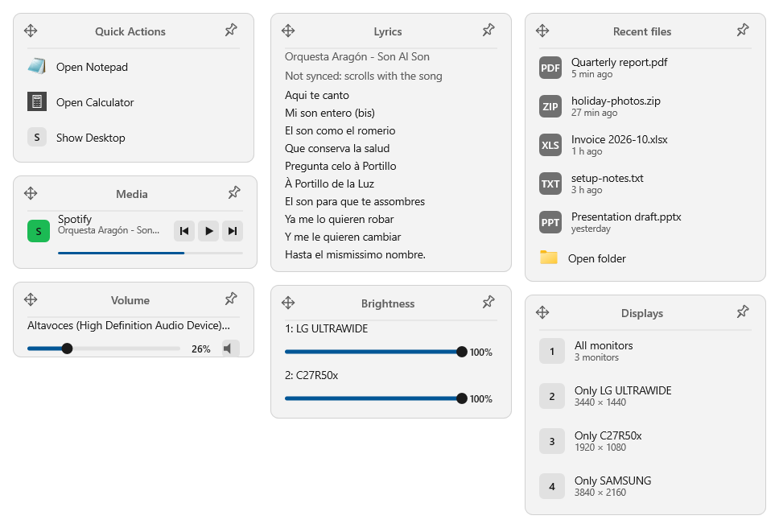

# EdgeDeck

[](https://github.com/BolsitaDP/edgedeck/actions/workflows/build.yml)
[](LICENSE)

*[Leer en español](README.es.md)*

EdgeDeck puts small tabs on the edge of your screen. Rest the pointer on one and a panel slides
out: launchers, media controls, volume, monitor brightness, song lyrics, display layouts, your
newest downloads. Move away and it slides back.

It is a native Windows utility written in C++ with Win32 and Direct2D - no Electron, no web view,
no .NET - and it is built to be forgotten about:

- **It never takes the focus.** Panels open without stealing the keyboard from the app you are
  typing in, and nothing EdgeDeck does pops a dialog in front of you.
- **It costs next to nothing.** About 20 MB of memory and no CPU at all while idle: no polling,
  no timers, no global mouse hooks. Everything happens in response to an event.
- **It stays out of your way.** Over a full-screen game or video the tabs step aside, as the
  taskbar does, and *Pause tabs* hides everything until you want it back.
- **It sends nothing anywhere.** No telemetry, no accounts. The only network request is the
  Lyrics tab asking [LRCLIB](https://lrclib.net) for the song that is playing, and only if you
  add that tab.

<picture>
  <source media="(prefers-color-scheme: dark)" srcset="docs/images/panels-dark-en.png">
  
</picture>

## The tabs

Each tab shows one kind of panel. Add, remove, move and resize them in Settings; you can have
several of the same kind, on the left or right edge of any monitor.

| Tab | What its panel does |
|---|---|
| **Quick Actions** | Your own list of things to open - programs, documents, folders, web addresses - each with its icon. Edit it in its own window, or drag files and shortcuts onto it from Explorer. |
| **Recent files** | The newest files in a folder (Downloads by default), with how long ago each arrived. Click one to open it. |
| **Media** | Every app that is playing something - Spotify, a browser tab, VLC - with previous, play/pause and next. |
| **Volume** | A slider and a mute button for each audio output device. |
| **Brightness** | A brightness slider for each external monitor that supports DDC/CI, and for a laptop's built-in screen. |
| **Lyrics** | The lyrics of whatever is playing, from LRCLIB: line by line in time with the song where LRCLIB has them synced, otherwise the plain text, scrolling as the song goes. |
| **Displays** | One click to switch which monitors are on. Save your own layouts (for example "desk monitors" or "just the TV") in **Layouts...**; with none saved it offers all monitors and each one alone. |

## Install

You need Windows 10 (version 1809 or later) or Windows 11, 64-bit.

Download **`EdgeDeck-<version>-setup-x64.exe`** from the
[latest release](https://github.com/BolsitaDP/edgedeck/releases/latest) (`setup-arm64` for a
Windows on ARM machine) and run it. It installs for your user only, without administrator rights,
in English or Spanish, and asks whether EdgeDeck should start with Windows. Running a newer one
later updates EdgeDeck in place, closing and restarting it.

Prefer no installer? The `EdgeDeck-<version>-win-x64.zip` has the same program: unzip it
anywhere and double-click **`Install.cmd`**.

EdgeDeck is not code-signed yet, so Windows SmartScreen may warn about an unknown publisher
(*More info* > *Run anyway*). Each release lists the SHA-256 of its files so you can check the
download is the published one.

EdgeDeck appears in **Settings > Apps > Installed apps**, where it is uninstalled like anything
else. Your settings, in `%LOCALAPPDATA%\EdgeDeck`, are kept (`uninstall.ps1 -RemoveSettings`
from the zip removes them too). *Check for updates* in EdgeDeck's menu opens the latest release;
EdgeDeck never checks on its own.

## Using it

- **Rest the pointer on a tab** to open its panel. It stays open while the pointer is on the tab or
  the panel, and closes a moment after you leave.
- **Pin a panel** with the pin in its top-right corner to keep it open; click the pin again to let
  it go.
- **Move a tab up or down** by holding the arrows in its panel's top-left corner and dragging; the
  tab stays where you let go.
- **Right-click a tab, or the EdgeDeck icon in the notification area,** for the menu: Settings,
  Edit quick actions, Pause tabs, Start with Windows, Open log, Restart, Check for updates, Report a
  problem and Exit. Left-clicking
  the notification-area icon opens Settings.
- **Settings** is where tabs are added and arranged, and where the theme, language, open delay and
  the other options below live.

### Keyboard

Panels never take the focus from the app you are using, so they are driven from the keyboard while
the pointer is over them. The system-wide shortcuts below are the defaults: change them, or turn any
of them off, in **Settings > Shortcuts...** - for example when another program already uses one.

| Keys | What they do |
|---|---|
| `Ctrl+Alt+1` ... `Ctrl+Alt+9` | Open and pin tab 1 to 9 |
| `Ctrl+Alt+P` | Pause or resume the tabs |
| `Ctrl+Alt+Q` | Exit EdgeDeck |
| `Ctrl+Alt+Shift+1` ... `9` | Switch to display layout 1 to 9 without opening the panel (only while there is a Displays tab) |
| Arrow keys | Move between the controls of the open panel; left and right also adjust a slider |
| Mouse wheel | Adjust the focused control |
| `Enter` / `Space` | Activate the focused control |
| `Esc` | Unpin and close the panel |

Screen readers are told what each panel and control is.

## Settings

Everything is set from the Settings window and saved to `%LOCALAPPDATA%\EdgeDeck\config.txt`, a
plain text file you can also edit by hand while EdgeDeck is closed.

| Setting | In Settings | In `config.txt` |
|---|---|---|
| Language (at first, Windows' own if it is Spanish, else English) | **Language**: English, Español | `language=en` |
| Shortcuts | **Shortcuts...** | `shortcutExit=Ctrl+Alt+Q`, `shortcutPause=`, `shortcutTabs=Ctrl+Alt`, `shortcutDisplays=Ctrl+Alt+Shift` (`none` turns one off) |
| Theme | **Theme**: follow Windows, always dark, always light | `theme=Follow` |
| Open delay | **Open delay**: how long the pointer must rest before a panel opens | `openDelayMs=0` |
| Full-screen apps | **Hide over full-screen apps** | `fullscreenGuard=1` |
| Start with Windows | **Start with Windows** | (the Windows startup list) |
| Recent files folder | **Recent folder**, or drop a folder on the window | `recentFolder=` (empty: Downloads) |
| Each tab | type, monitor, edge, vertical position, tab and panel size | a `[tab]` section each |
| Quick actions | **Actions...** (with a Quick Actions tab selected) | an `[action]` section each |
| Restart after a crash | - | `restartAfterCrash=1` |
| Display layouts | **Layouts...** (with a Displays tab selected) | a `[layout]` section each: `name=`, `monitors=` (EDID ids) |

The panels follow your Windows accent colour, light or dark mode, and high-contrast colours.

If something goes wrong, EdgeDeck writes it to `%LOCALAPPDATA%\EdgeDeck\edgedeck.log` (*Open log* in
the menu). After a crash it restarts itself once and leaves a small crash dump next to the log,
which is the most useful thing to attach to a bug report. *Report a problem...* in the menu opens a
new bug report with your EdgeDeck and Windows versions and your monitors filled in, and puts the end
of the log on the clipboard to paste into it (your user folder is masked); nothing is sent until you
post it.

If `config.txt` cannot be read, or was saved by a newer EdgeDeck, EdgeDeck says so when it starts
and keeps a copy as `config.backup.txt` before anything writes over it.

## Building from source

You need CMake 3.20 or later and Visual Studio 2022 (or its Build Tools) with the C++ desktop
workload and a Windows SDK.

```powershell
cmake -S . -B build -G "Visual Studio 17 2022" -A x64
cmake --build build --config Release
ctest --test-dir build -C Release --output-on-failure
```

The C++ runtime is linked into the executable, so `EdgeDeck.exe` runs on a clean Windows without
any redistributable. To run your build the way the release does, use
`scripts\install.ps1 -Build`; `scripts\package.ps1` makes the release zip (`-Architecture arm64` for
Windows on ARM, which needs the MSVC ARM64 build tools).

## Contributing

Bug reports, translations and pull requests are welcome. [CONTRIBUTING.md](CONTRIBUTING.md) explains
how the code is organised, the rules every change keeps (the main one: EdgeDeck must stay
nearly free to run), and how to test. The design notes behind the less obvious decisions are in
[docs/DESIGN.md](docs/DESIGN.md), and the desktop test tools in [tools/README.md](tools/README.md).

## License

[MIT](LICENSE).
